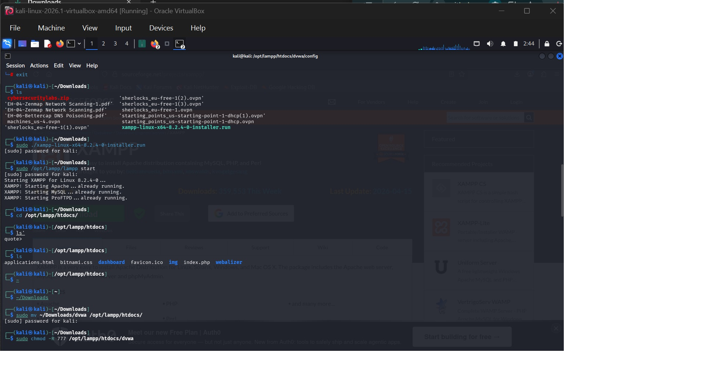
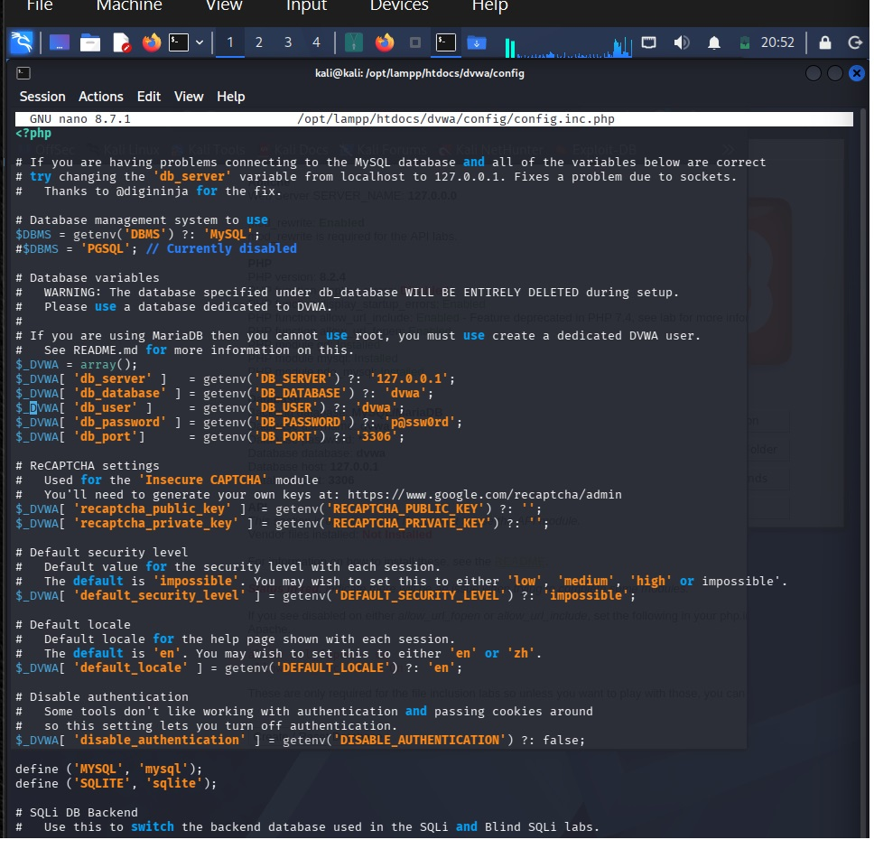
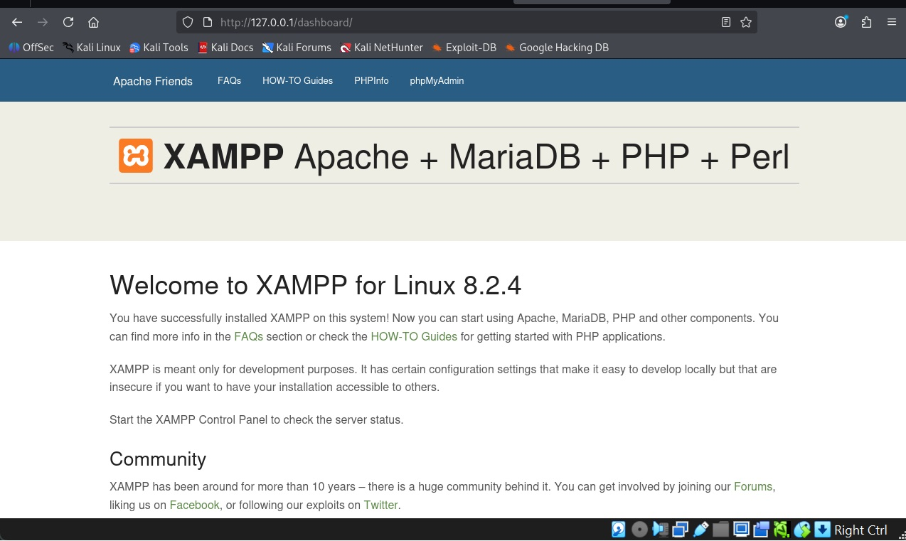
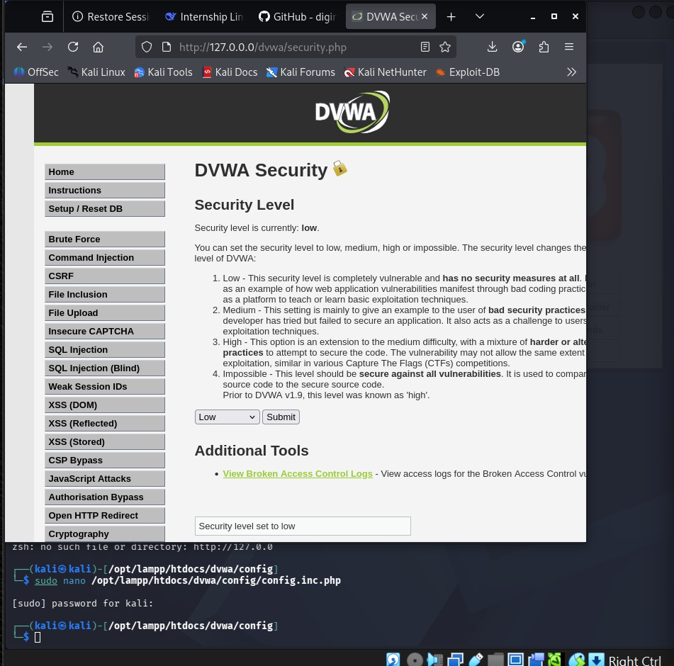
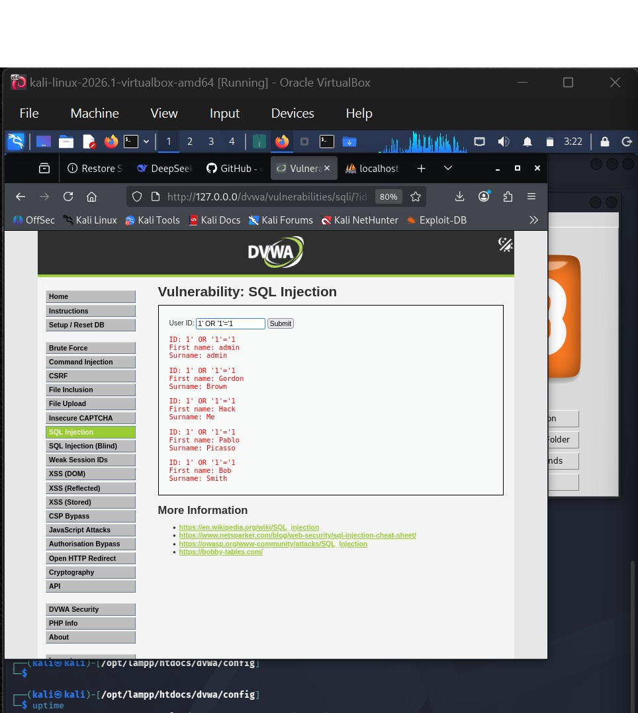
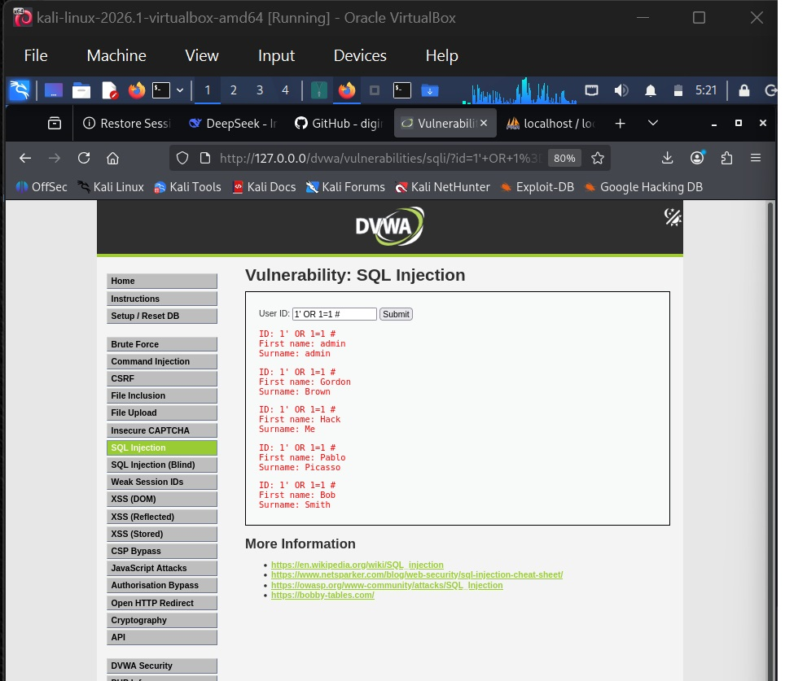
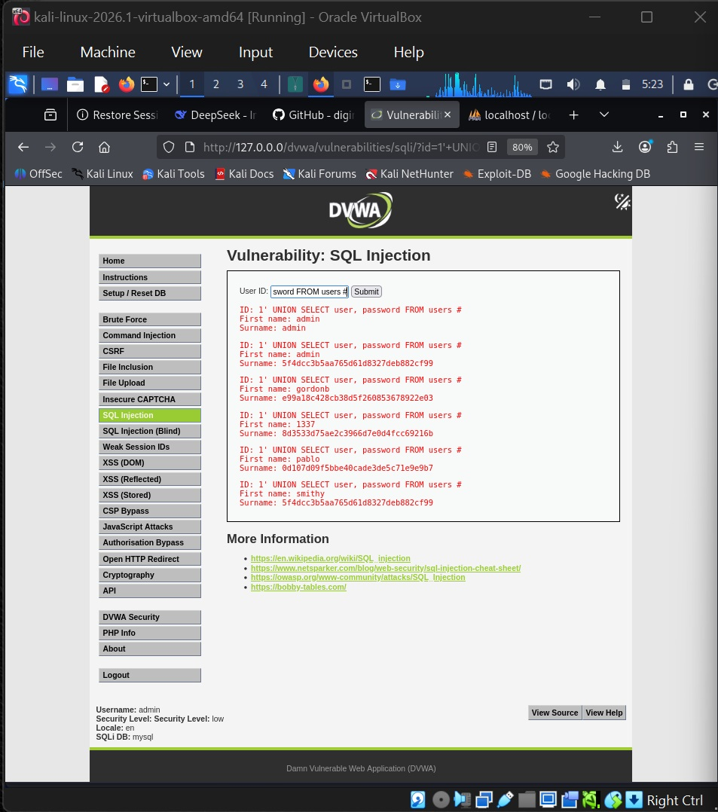

# Task 3: SQL Injection on DVWA (Low Security)

## Overview
This project walks through a classic SQL Injection (SQLi) attack on the login/user ID form of the **Damn Vulnerable Web Application (DVWA)** set to its **Low** security level. The goal here is to document the whole lab process from scratch, break down how the payloads manipulate the database, look at what data gets exposed, and explain how developers actually patch these vulnerabilities in real applications.

---

## 1. What is SQL Injection?
SQL Injection is basically a security flaw where a website takes user input and blindly stitches it straight into a database query without checking it first. Because the app doesn't separate user text from actual code, an attacker can type in special SQL commands. The database gets tricked into running those commands, which lets people bypass authentication, read restricted tables, or dump entire databases.

---

## 2. Local Environment Setup & Configuration
To practice this safely, I set up the lab locally on a Kali Linux virtual machine running inside VirtualBox.

* **Tools Used**: DVWA hosted locally via XAMPP (Apache and MySQL), accessed through a web browser.
* **Setup Steps**:
  1. Downloaded and unpacked the XAMPP package, then gave the installer script execution permissions in the terminal:
     ```bash
     chmod +x xampp-linux-x64-8.2.4-0-installer.run
     ```
  2. Ran the installer to get Apache and MySQL up and running.
     *(Terminal Setup / Installer Execution)*
     

  3. Went into the local server directory (`/opt/lampp/htdocs/dvwa/config/`) and edited the `config.inc.php` file using nano to hook up local MySQL root credentials.
     *(Configuration File Editing)*
     

  4. Opened up the browser to verify that the local server dashboard was live and serving pages.
     *(XAMPP Dashboard)*
     

  5. Headed over to the DVWA setup page, built the database tables, and logged in (`admin` / `password`).
  6. Clicked on **DVWA Security** in the sidebar and dropped the security level down to **Low**. This turns off input filtering, character escaping, and token checks so we can see how legacy, insecure code behaves.
     *(Security Level Set to Low)*
     

---

## 3. Attack Execution, Payloads, Mechanics & Data Exposure
I navigated straight to the **SQL Injection** module in DVWA to test out a few different payloads.

### Payload 1: Boolean Logic Bypass (`1' OR '1'='1`)
* **How it works**: The single quote (`'`) closes out the developer's original string early. Adding `OR '1'='1'` tacks on a condition that is always true. Since that check never fails, the database's `WHERE` clause matches every single row in the users table.
* **Data Exposed**: It bypasses the login logic entirely and dumps every user's ID, first name, and surname right onto the page.
* **Execution Output**:
  

### Payload 2: Query Commenting Bypass (`1' OR 1=1 #`)
* **How it suffers**: This one uses the hash symbol (`#`), which tells MySQL to treat everything after it as a comment. It forces the database to ignore any trailing quotes or syntax left over by the original developer so the query doesn't throw a syntax error.
* **Data Exposed**: Successfully tricks the backend into bypassing restrictions and outputting the full user roster.
* **Execution Output**:
  

### Payload 3: Credential Extraction via UNION (`1' UNION SELECT user, password FROM users #`)
* **How it works**: The `UNION` operator tells the database to stitch the results of the app's original query together with a brand-new, unauthorized query of our choosing. The `#` comments out the rest of the original code so the syntax stays valid.
* **Data Exposed**: Pulls usernames and password hashes straight out of restricted columns and displays them on the interface.
* **Execution Output**:
  

---

## 4. How a Developer Would Fix This Vulnerability
To actually secure code against SQL injection, developers need to stop using messy string concatenation and use proper defense-in-keeping practices:

1. **Parameterized Queries (Prepared Statements)**: This is the gold standard. Prepared statements treat user input strictly as data, never as executable code. Even if someone types SQL commands into a form field, the database just reads it as plain text.
2. **Strict Input Validation**: Checking incoming data to make sure it matches expected types, character sets, and length limits before it ever touches the database layer.
3. **Principle of Least Privilege**: Ensuring the database user account connected to the web app only has permissions for what it absolutely needs to do, limiting the damage if a bug is ever exploited.
